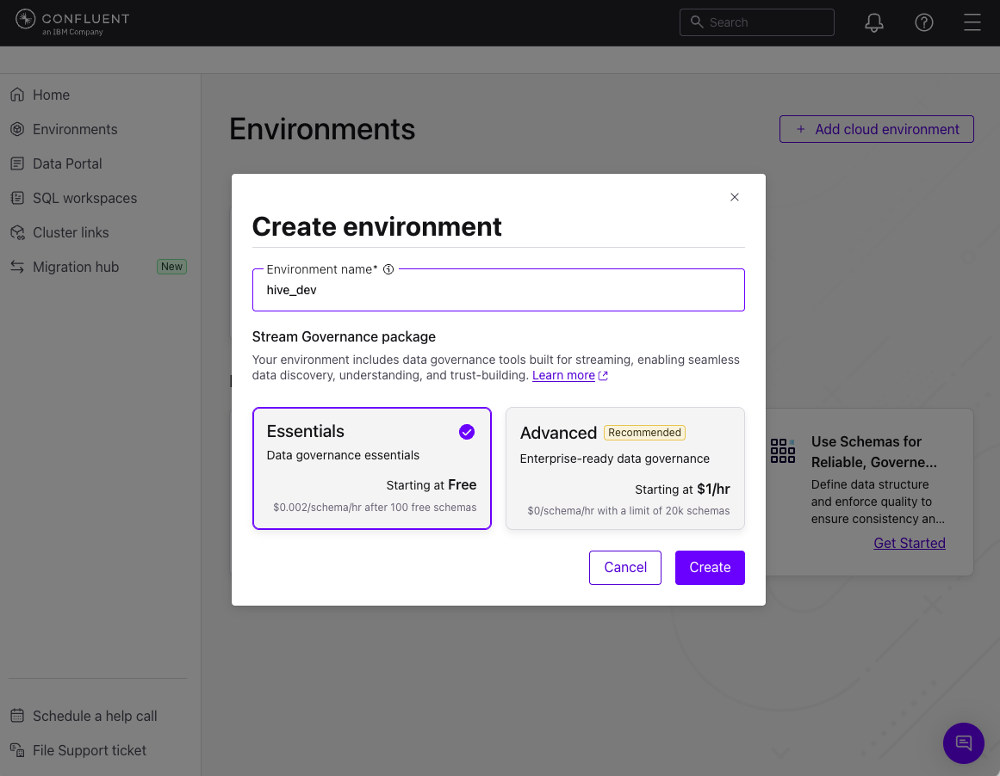

# Level 0: Kickoff & Unified Dashboard Setup

Welcome to **Level 0** of the Hive Robotics Workshop!

Wou will set up your local development environment, configure your Confluent Cloud and simulation credentials in `spec-shared/.env` then launch the **Hive Dashboard** to get your first view into your personal Hive simulation.

We don't have time to explain why event-driven architectures are powerful, but we recommend reading O'Reilly's Building Event Driven Microservices.  We've provided a [copy of the book in level-0-hive-dashboard/assets of your cloned repo](assets)


---

## Architecture Overview

Throughout the entire workshop, you will use this **single unified dashboard** install:

- **Backend** (`backend/`): FastAPI service that connects to Confluent Cloud via `confluent-kafka` and streams live factory projections to the UI over Server-Sent Events (SSE).
- **Frontend** (`frontend/`): React + TypeScript + Vite UI displaying the robotic manufacturing floor, factory controls, and the level progression selector.

As you advance through the workshop, you will select your active level from the top dropdown, and automated validation tests will verify that your stream processing jobs and data pipelines are running.

Your dashboard connects to two things:

1. **The Simulation Server (factory engine)**: simulates resource gathering, parts manufacturing, and robot assembly.
2. **Confluent Cloud (event backbone)**: a managed Apache Kafka cluster that carries every event the factory publishes.

```
              ┌───────────────────────────────┐
              │   Simulation Server (Engine)  │
              └──────┬─────────────────▲──────┘
  Kafka events       │                 │ HTTP REST commands
  (10 topics)        ▼                 │ (Run / Pause / Stop / Restart)
              ┌──────────────┐         │
              │  Confluent   │         │
              │    Cloud     │         │
              └──────┬───────┘         │
                     │ Kafka consumer  │
                     ▼                 │
              ┌──────────────────────────────┐
              │  Local Python / FastAPI      │
              │  Backend                     │
              └──────────────┬───────────────┘
                             │ Server-Sent Events (SSE)
                             ▼
              ┌───────────────────────────────┐
              │     React Dashboard (UI)      │
              └───────────────────────────────┘
```

### Key concept: stream observation

Your dashboard does **not** query a factory database. It builds an in-memory, real-time view of the factory floor only from the Kafka events streamed through Confluent Cloud. If the stream stops, your view stops too. This is event-driven decoupling in practice.

---

## Step 1: Prerequisites

Make sure you have:
- **Python 3.12+**
- **Node.js 18+** & npm
- A [Confluent Cloud](https://confluent.cloud) account
- Your workshop access token and attendee ID, issued by the instructor

---

## Step 2: Create Your Confluent Cloud Environment (`hive_dev`)

Skip this step if you already have a `hive_dev` environment with a Kafka cluster and an API key.

1. Log in to [Confluent Cloud](https://confluent.cloud).
2. In the left navigation, select **Environments**, then click **+ Add cloud environment**.
3. Enter `hive_dev` as the **Environment name**.
4. Under **Stream Governance package**, leave **Essentials** selected (starts at Free). This turns on **Schema Registry**, which Level 2 and Level 3 need.
5. Click **Create**.

   

6. Create a Kafka cluster in the `hive_dev` environment: **Basic** or **Standard**, on **Google Cloud** in a US region (for example `us-west1`). Note the region, because the Flink compute pool you create in Level 2 must use the same one.
7. Create a cluster API key and secret under **API Keys > Add key > My account**. Copy the secret now, because Confluent only shows it once. You will use these as `CONFLUENT_API_KEY` and `CONFLUENT_API_SECRET` in the next step.

---

## Step 3: Configure Environment Credentials (`spec-shared/.env`)

The backend and topic provisioning scripts read configuration from `spec-shared/.env`.

1. Copy the example environment template from the repository root or `spec-shared/`:

   ```bash
   cp spec-shared/.env.example spec-shared/.env
   ```

2. Open `spec-shared/.env` in your editor and configure the following required values:

   ```ini
   # Simulation server URL (the default works for a server running on your machine;
   # use the HTTPS URL from your instructor if they host it)
   SIMULATION_SERVER_URL=http://localhost:8080

   # Organizer-issued bearer token for authenticating with the simulation server
   WORKSHOP_ACCESS_TOKEN=your-issued-access-token
   
   # Your attendee identifier (e.g. queen-042)
   ATTENDEE_ID=your-attendee-id

   # ── 2. Confluent Cloud Cluster Credentials ────────────────────────────────
   # Confluent Cloud -> Cluster Settings -> Bootstrap server (e.g. pkc-xxxxx.us-west-2.aws.confluent.cloud:9092)
   CONFLUENT_BOOTSTRAP_SERVER=pkc-xxxxx.us-west-2.aws.confluent.cloud:9092

   # API Key & Secret with cluster access (Confluent Cloud -> API Keys)
   CONFLUENT_API_KEY=your-api-key
   CONFLUENT_API_SECRET=your-api-secret

   # ── 3. Topic Provisioning Settings (Confluent REST API) ───────────────────
   # Confluent Cloud -> Cluster Settings -> Endpoints -> REST endpoint
   CONFLUENT_REST_ENDPOINT=https://pkc-xxxxx.us-west-2.aws.confluent.cloud
   
   # Confluent Cloud -> Cluster Settings -> General -> Cluster ID (e.g. lkc-xxxxxx)
   CONFLUENT_CLUSTER_ID=lkc-xxxxxx
   ```

3. Save `spec-shared/.env`.

---

## Step 4: Start the Backend Service

Once `spec-shared/.env` is configured, start the backend service:

```bash
cd level-0-hive-dashboard/backend
./start_backend.sh
```

*(Alternatively, create a virtual environment, run `pip install -r requirements.txt`, and start uvicorn on port 8001).*

The backend will start at **`http://localhost:8001`**.

---

## Step 5: Start the Frontend UI

Open a second terminal and start the frontend development server:

```bash
cd level-0-hive-dashboard/frontend
npm install
npm run dev
```

Open your browser at **`http://localhost:5174`** (or the port displayed in your terminal).

---

## Step 6: Verification & Next Steps

When the dashboard loads:
1. You will see the **Hive Robotics** floor interface.
2. The connection status indicator and level selector dropdown will be visible.

Now proceed to **Level 1** to provision your Kafka topics and connect the live simulation stream:

👉 **[`level-1-connect-simulation/README.md`](../level-1-connect-simulation/README.md)**
