# Stream Processing with Apache Flink (Confluent Cloud)

## Overview & Goal

In the Hive workshop, your factory simulation emits discrete lifecycle events across different Kafka topics as resources are collected, components are manufactured, and worker robots are assembled. 

However, raw events only tell you what happened at an instant in time:
- A `*.started` event announces that a job began.
- A `*.completed` event announces that the job finished.

**The Problem:** There is no single event that tells you how long a job actually took, whether it ran on schedule, or how station performance is trending across stages.

**Your Objective:** As a stream processing engineer, you will use **Apache Flink on Confluent Cloud** to correlate unbounded event streams in real time. You will build an interval-join pipeline that pairs started and completed events by `job_id`, calculates accurate job durations, and outputs continuous, typed performance metrics to a unified `job_durations` stream.

```
┌─────────────────────────┐
│   *.started topic       ├──┐
└─────────────────────────┘  │   Flink Stateful Join
                             ├──► (matches on job_id)  ───►  job_durations table & topic
┌─────────────────────────┐  │   [within 1-min window]      (Schema Registry + Tableflow ready)
│   *.completed topic     ├──┘
└─────────────────────────┘
```

---

## What You Are Building

### 1. Input Streams
Your factory publishes raw JSON events across three production stages (defined in [`spec-shared/schemas/event_payloads.json`](../spec-shared/schemas/event_payloads.json)):

| Production Stage | Started Topic | Completed Topic | What It Represents |
|---|---|---|---|
| **Gathering** | `gathering-started` | `gathering-completed` | Resource extraction (pollen, nectar, wax) |
| **Manufacturing** | `manufacturing-started` | `manufacturing-completed` | Component production at stations (frames, honeycombs) |
| **Assembly** | `assembly-started` | `assembly-completed` | Final robot assembly lines |

Each event is wrapped in a standard envelope containing metadata (`occurred_at`, `sim_time_minutes`, `factory_id`, `run_id`) and a `payload` containing `job_id` and the details of the job (resource, station or output).

### 2. Output Stream (`job_durations`)
Flink produces a unified, append-only stream and backing Kafka topic named `job_durations`:

| Derived Metric / Field | Source / Calculation | Why It Matters |
|---|---|---|
| `job_id` | Shared `payload.job_id` | Correlates both events together |
| `stage` | `gathering`, `manufacturing`, or `assembly` | Allows cross-stage filtering and grouping |
| `subject` / `output_id` | `resource_id` or `station_id` | Identifies which station or item type was worked on |
| `elapsed_sim_minutes` | `completed.sim_time_minutes - started.sim_time_minutes` | **Exact simulated duration.** Independent of clock drift or simulation speed. |
| `elapsed_wall_s` | Difference between `occurred_at` timestamps | **Real-world duration in seconds.** Measures real wall-clock latency. |

---

## Why Stream-to-Stream Joins Need Watermarks and Windows

In traditional databases, you can join two tables at any time because all rows are stored on disk. In stream processing, events arrive continuously over time over unbounded streams. 

If Flink joined streams without time constraints, it would have to keep every `started` event in memory forever waiting for a possible `completed` event, eventually exhausting memory.

To solve this, our Flink queries use an **Interval Join**:
```sql
ON  s.job_id = c.job_id
AND c.row_time BETWEEN s.row_time - INTERVAL '5' SECOND AND s.row_time + INTERVAL '1' MINUTE;
```
This tells Flink:
1. Match records where `job_id` is identical.
2. Only retain state for 1 minute of Kafka record time. Once a `started` event is older than 1 minute without a match, it is evicted from state, keeping memory usage minimal and bounded.

---

## Step-by-Step Instructions

You will first configure your environment and run the pipeline using the **Confluent Cloud Web UI**. Once you understand how the jobs operate, you can optionally switch to the **Confluent CLI**.

---

### Step 1: Initial Setup via Confluent Cloud UI

> **Note on Schema Registry:** Schema Registry is already active because you selected the **Essentials** Stream Governance package when creating the `hive_dev` environment in Spec 1.

1. **Create Your Flink Compute Pool**:
   - From the home page of your Confluent Cloud instance, select **Environment** from the left navigattion
   - Click into your `hive_dev` environment then click into **Compute Pools**.

    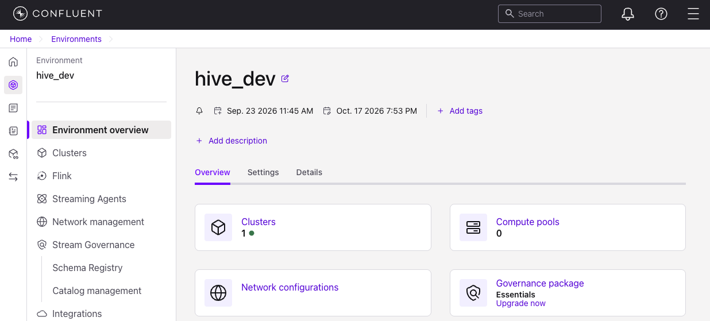

   - In the left navigation, click **Flink** and go to the **Compute pools** tab.
   - Click **Add compute pool**.

   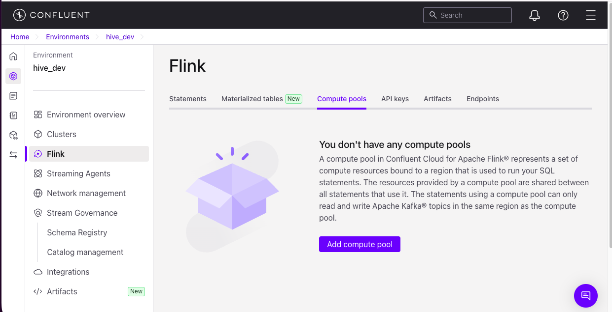

   - Select **Google Cloud** as the provider and **Oregon (us-west)** as the region (or a region closer to you). Click **Continue**.

   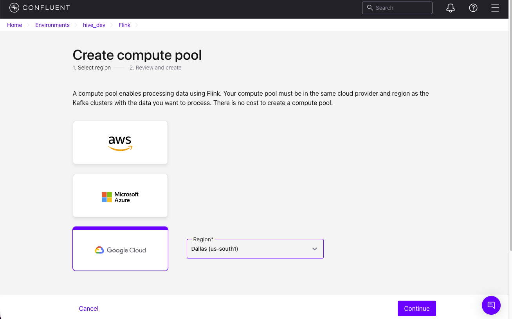

   - Rename your **Pool name** to `hive_compute_pool` and click **Create**.

   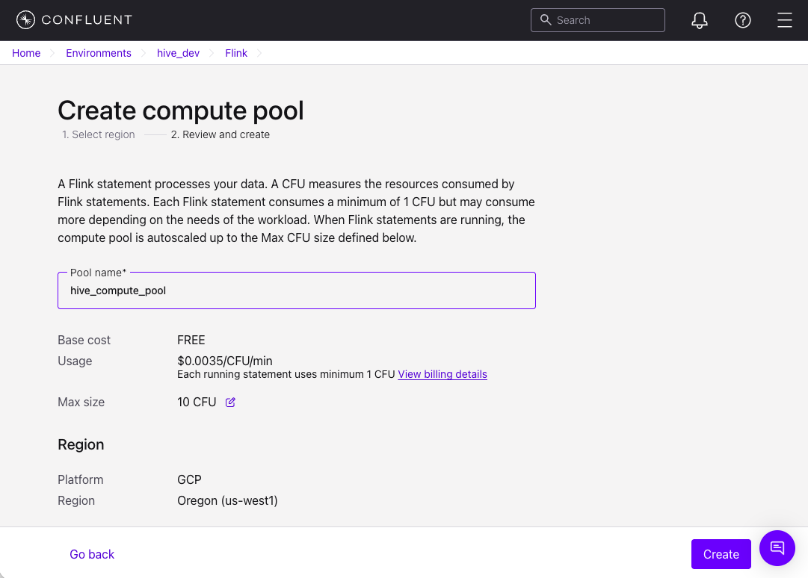

2. **Open the Flink SQL Workspace & Set Context**:
   - From your Compute Pool screen, click **SQL Workspace** at the top.

   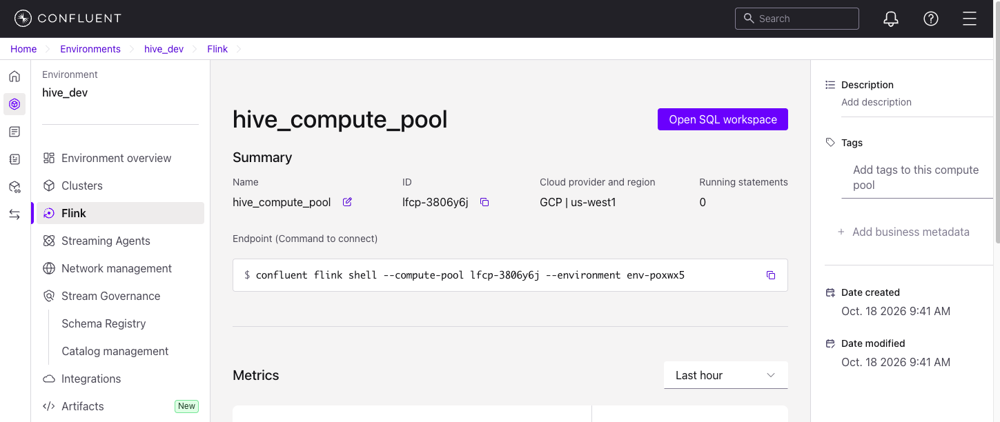≈
   
   - **Configure Context Dropdowns:** In the-right of the header bar:
     - **Catalog**: Select `hive_dev` (your environment name as Flink refers to the **Environment** as **Catalog**)
     - **Database**: Select your Kafka cluster name (e.g. `hive_cluster_1`, as Flink refers to the **Cluster** as **Database**)

   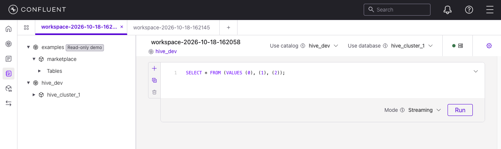≈

   - Click the Gear icon at top-right to edit your workspace settings:
     - **Rename Your Workspace:** to **`hive_job_durations`**.
     - **Compute pool**: Select your newly created pool (e.g. `hive_compute_pool`).

    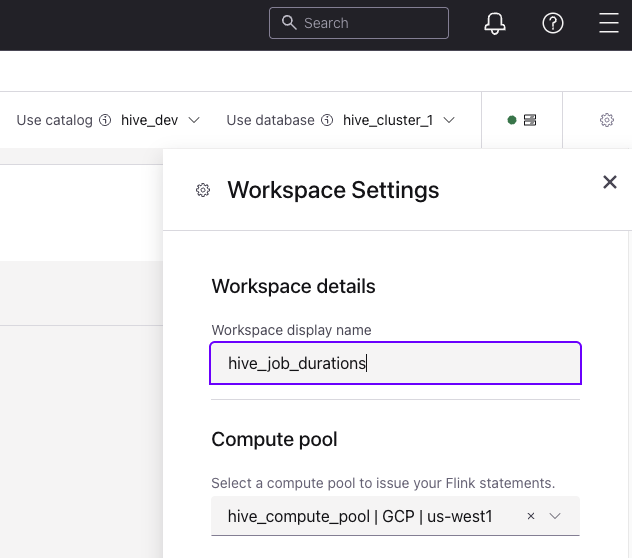≈
   
---

### Step 2: Execute Flink SQL Statements in the Workspace

#### A. Ensure Factory Data is Flowing
Start by ensuring your dashboard is:
- Connected to the Hive simulation server and running (see [`spec-3-hive-dashboard/attendee_get_started.md`](../spec-3-hive-dashboard/attendee_get_started.md)).
- The simulation timer should be incrementing up.
- This ensures Kafka events are actively published to `gathering-*`, `manufacturing-*`, and `assembly-*` topics.

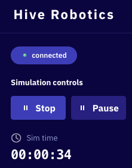

#### B. Prepare SQL execution windows
1. Click the **+** button next to the SQL workspace cell **twice** so you have a total of 3 workspace cells.
2. If there is text in the first cell, delete as it's not needed.

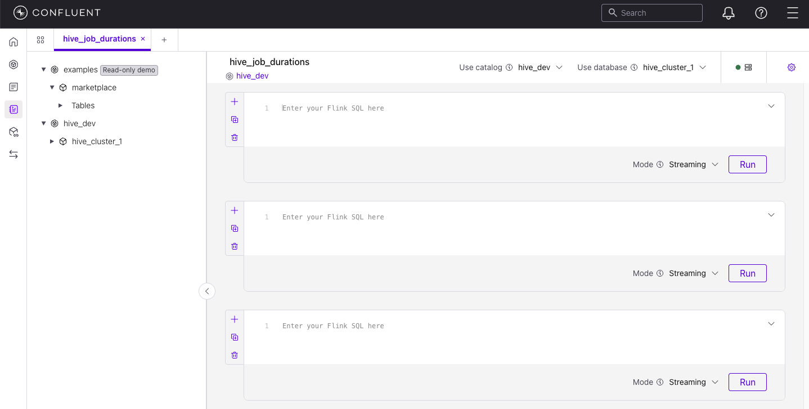

#### C. Create the Sink Table
1. Open [`flink/01_create_sink.sql`](flink/01_create_sink.sql).
2. Copy the entire SQL statement, paste it into the **first workspace cell** and click **Run**.
  - **What this does:** Registers the `job_durations` table in Flink, generates the registered schema in Schema Registry, and creates the underlying Kafka topic with `append` changelog mode.
  - **Expected status:** **Completed**. This DDL statements executes once and finishes immediately.

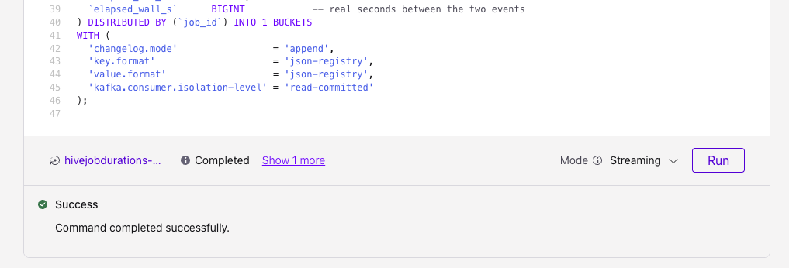

#### C. Deploy the Stream Processing Jobs
1. Open [`flink/02_run_jobs.sql`](flink/02_run_jobs.sql).
2. Copy the entire `EXECUTE STATEMENT SET ... BEGIN ... END;` block, paste it into the **second workspace cell** and click **Run**.
  - **What this does:** Submits three continuous streaming jobs (gathering, manufacturing, assembly) bundled into a single Flink statement. Flink continuously joins incoming `started` and `completed` events and writes the correlated duration records into `job_durations`.
  - **Expected status:** **Running**. Unlike the earlier DDL commands creating the Sink table, stream processing queries are continuous, long-running background jobs that stay active on your compute pool, listening for incoming Kafka events and calculating durations in real time.
  - Ignore the warning.  This is because the simulation event producer is not using the Confluent's Schema Registry to keep this workshop simple to start.
3. So do **not** click **Stop**.  Clicking the red **Stop** button cancels and terminates your background Flink streaming pipeline.
  - After the next step, we will close this SQL Workspace while leaving this stream processing queries running in the background.

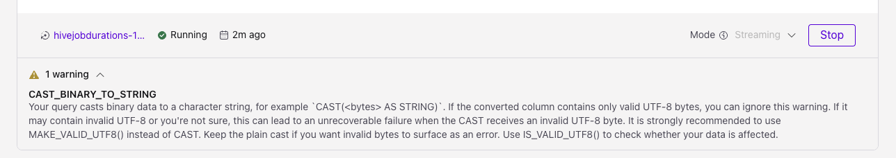

#### E. Validate the Streaming Output
1. Open [`flink/03_validate.sql`](flink/03_validate.sql).
2. Copy the entire SQL block, paste it into the **third workspace cell** and click **Run**.
3. Wait a few seconds to confirms derived duration records are being generated by Flink.
4. Once you have verified records are being generated, click **Stop** as this 3rd command does not need to run anymore.

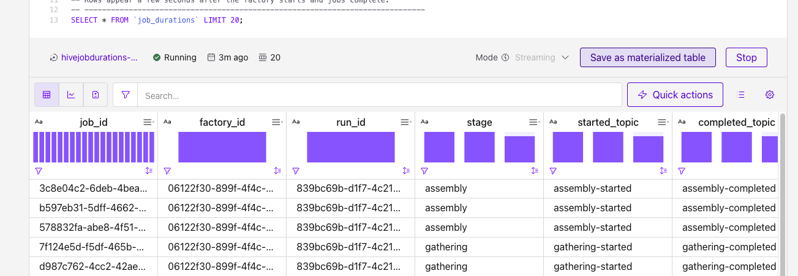

#### F. Close this SQL workspace
Click the **x** next to the SQL Workspace name to close it as we are done.

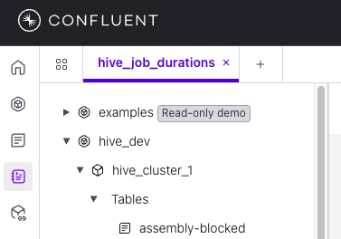

#### G. View Your Running Flink Statement in the Console
To inspect and verify your active streaming statement running on your compute pool:
1. Navigate back to your **`hive_dev`** environment.
2. In the left navigation, click **Flink** and go to the **Statements** tab.
3. You will see the statements that you just executed listed.  Ensure only the Statement of type **Execute Statement Set** has status **Running**:

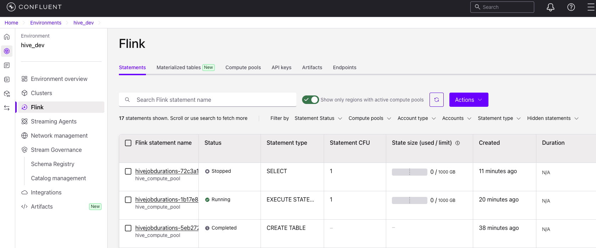

> **⚠️ Gate Check — Do Not Proceed If Not Running:**
> Your statement status must be **Running**. If it is stopped or missing, verify that your factory simulation is running, ensure your compute pool is active, and re-run [`flink/02_run_jobs.sql`](flink/02_run_jobs.sql).

4. Click on the statement name to open its **Statement Details** page:

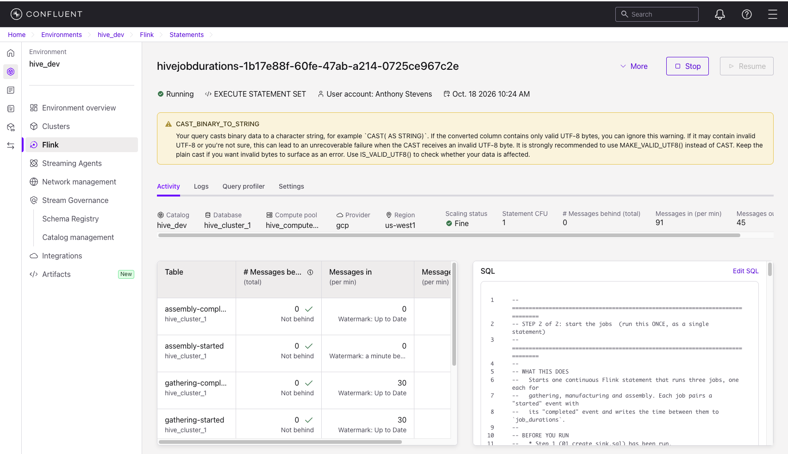

- **Catalog & Cluster:** Confirms binding to `hive_dev` and `hive_cluster_1`.
- **Throughput by Table:** Shows live messages in and out across `gathering-*`, `manufacturing-*`, and `assembly-*` topics.
- **SQL Definition:** Displays the running statement set and joins.

5. Scroll down to inspect the **Activity Trends** charts:

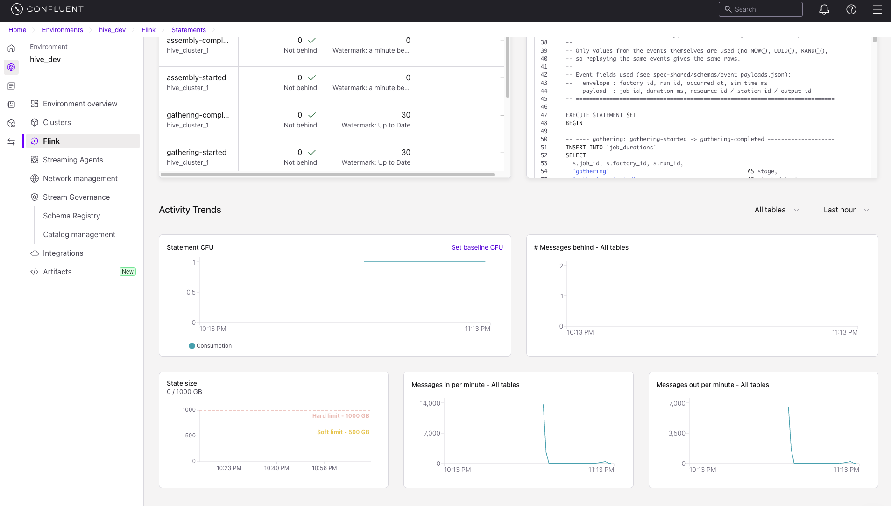

- **Statement CFU:** Shows Confluent Flink Units allocated to this pipeline.
- **Messages behind (Lag):** Confirms Flink is processing in real time with near-zero lag.
- **Messages in/out per minute:** Visualizes incoming factory events and derived duration records being produced.

---

## Switching to Confluent CLI (Optional)

After exploring the UI, you can manage compute pools, submit statements, and run interactive SQL sessions directly from your terminal.

### 1. Install the Confluent CLI

#### macOS
Install via Homebrew:
```bash
brew install confluentinc/tap/cli
```
Or via curl:
```bash
curl -sL --http1.1 https://cnfl.io/cli | sh -s -- -b /usr/local/bin
```

#### Windows
Install via PowerShell:
```powershell
Invoke-WebRequest -Uri https://cnfl.io/cli -OutFile confluent-cli-install.ps1
powershell -ExecutionPolicy Bypass -File confluent-cli-install.ps1 -bin %USERPROFILE%\bin
```
Or via winget:
```powershell
winget install Confluent.ConfluentCLI
```

Verify the installation:
```bash
confluent version
```

### 2. Authenticate & Configure Context

1. Log in to Confluent Cloud:
   ```bash
   confluent login --save
   ```
2. Set your environment and Kafka cluster:
   ```bash
   confluent environment list
   confluent environment use <ENV_ID>

   confluent kafka cluster list
   confluent kafka cluster use <CLUSTER_ID>
   ```
3. List available Flink compute pools:
   ```bash
   confluent flink compute-pool list
   ```

### 3. Run Flink SQL via CLI

Submit a statement directly from a file:
```bash
confluent flink statement create create-job-durations-sink \
  --compute-pool <COMPUTE_POOL_ID> \
  --environment <ENV_ID> \
  --database <CLUSTER_ID> \
  --sql "$(cat flink/01_create_sink.sql)"
```

Or open an interactive Flink SQL shell:
```bash
confluent flink shell \
  --compute-pool <COMPUTE_POOL_ID> \
  --environment <ENV_ID> \
  --database <CLUSTER_ID>
```

---

## Technical Notes & Best Practices

- **Topic Creation:** `provision_topics.py` provisions the source topics. Do **not** pre-create `job_durations` manually; Flink creates and manages this topic and its schema.
- **JSON Parsing (`CAST(val AS STRING)`):** The source Kafka topics contain plain JSON records. Using `CAST(val AS STRING)` ensures string compatibility for `JSON_VALUE` parsing regardless of whether the column is typed as `BYTES` or `STRING`.
- **Timestamp Resolution:** `elapsed_sim_minutes` is exact and simulation-speed independent. `elapsed_wall_s` uses coarse whole seconds and will vary based on factory simulation speed.
- **Schema Registry & Tableflow:** The sink table uses `json-registry` (`JSON_SR`). Because Tableflow automatically materializes Kafka topics into Apache Iceberg tables, having a registered schema is mandatory.
- **Changelog Immutability:** The changelog mode is set to `append` in the DDL. Once a topic is materialized in Tableflow, its changelog mode cannot be changed.

---

## Workshop Teardown & Resource Cleanup

> **Note:** Only perform these steps when you have completed all workshop exercises and are ready to clean up cloud resources.

To stop compute charges at the conclusion of the workshop:
1. Navigate to **Flink statements** in Confluent Cloud.
2. Find your running statement set and click **Actions > Delete** (or **Stop**).
3. If no further Flink exercises are planned, navigate to **Compute pools** and delete your compute pool.
