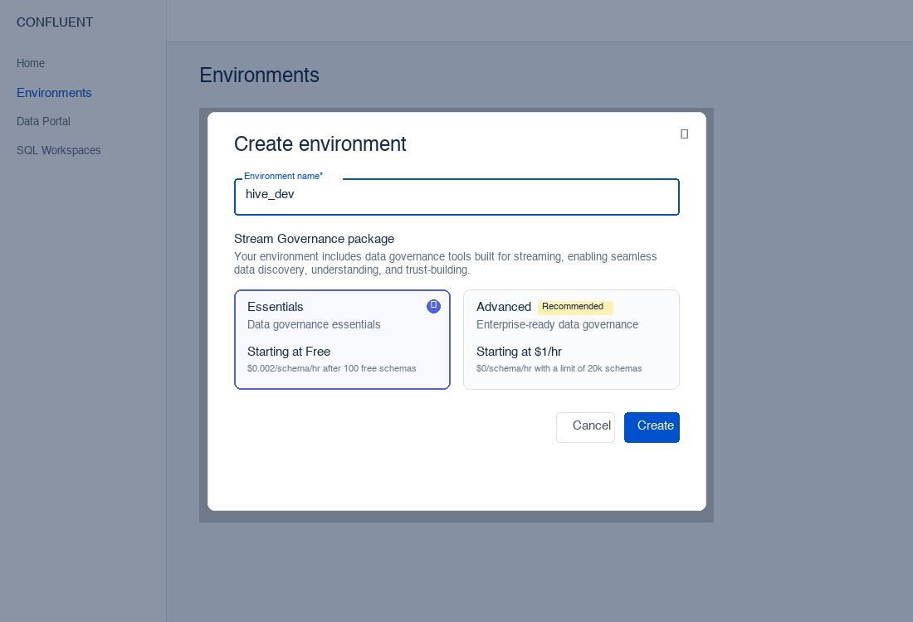

# Attendee Quickstart: Hive Manufacturing Dashboard

Welcome to the **Hive Workshop**! In this hands-on session, you will connect your own engineer workstation to an automated robotic manufacturing facility powered by **Confluent Cloud** and event-driven architecture.

---

## Workshop Architecture & What You Are Doing

In this exercise, you are running your local control station: a **React / TypeScript frontend** and a **Python / FastAPI backend**. Your application connects to:

1. **The Simulation Server (Factory Engine)**: A central service simulating resource extraction, component manufacturing, and robot assembly.
2. **Confluent Cloud (Event Backbone)**: A managed Apache Kafka cluster that carries every discrete event published by the factory.

```
                  ┌───────────────────────────────┐
                  │   Simulation Server (Engine)  │
                  └──────┬─────────────────▲──────┘
    Kafka Events         │                 │ HTTP REST Commands
    (10 topics)          ▼                 │ (Start / Pause / Speed)
                  ┌──────────────┐         │
                  │  Confluent   │         │
                  │    Cloud     │         │
                  └──────┬───────┘         │
                         │ SSE / Stream    │
                         ▼                 │
                  ┌────────────────────────┴──────┐
                  │ Local Python / FastAPI Backend│
                  └──────────────┬────────────────┘
                                 │ WebSockets / SSE
                                 ▼
                  ┌───────────────────────────────┐
                  │     React Dashboard (UI)      │
                  └───────────────────────────────┘
```

### Key Concept: Stream Observation
Your dashboard does **not** query an internal factory database. Instead, it builds an in-memory real-time view of the factory floor strictly by consuming Kafka events streamed from Confluent Cloud. If the stream stops, your view pauses — demonstrating true event-driven decoupling.

---

## Prerequisites & Environment Setup

Before starting, ensure you have:
- **Python 3.11+**
- **Node.js 22.12+** and **npm**
- Access to [Confluent Cloud](https://confluent.cloud)
- Your workshop credentials (`WORKSHOP_ACCESS_TOKEN` provided by the instructor).

---

### Step 0 — Create Your Confluent Cloud Environment (`hive_dev`)

1. Log in to [Confluent Cloud](https://confluent.cloud).
2. In the left navigation, select **Environments**.
3. Click **+ Add cloud environment** (or **Create environment**).
4. Enter `hive_dev` as the **Environment name**.
5. Under **Stream Governance package**, select **Essentials** (starts at Free). This automatically enables **Schema Registry**, which is required for stream processing and Tableflow in later steps.
6. Click **Create**.



7. Create (or open) your Kafka cluster within the `hive_dev` environment (Basic or Standard cluster in your preferred cloud/region).
8. Generate a cluster API key and secret under **API Keys > Add key > My account**.

---

### Step 1 — Configure `.env`

In `spec-2-hive-dashboard/`, copy the example environment configuration:
```bash
cp .env.example .env
```
Open `.env` and fill in your connection details from Confluent Cloud and your workshop token:
- `SIMULATION_SERVER_URL`: URL of the simulation server (default: `http://localhost:8080`).
- `WORKSHOP_ACCESS_TOKEN`: Your assigned workshop bearer token.
- `CONFLUENT_BOOTSTRAP_SERVER`: Kafka bootstrap broker endpoint (e.g. `pkc-xxxx.us-east-1.aws.confluent.cloud:9092`).
- `CONFLUENT_API_KEY` & `CONFLUENT_API_SECRET`: Your Kafka API key and secret.
- `CONFLUENT_REST_ENDPOINT`: Confluent cluster REST endpoint (e.g. `https://pkc-xxxx.us-east-1.aws.confluent.cloud`).
- `CONFLUENT_CLUSTER_ID`: Your cluster ID (e.g. `lkc-xxxxxx`).

---

## Step-by-Step Instructions

### Step 2 — Provision Your Factory Kafka Topics

Run the provisioning script from the `spec-2-hive-dashboard/` directory. It automatically configures a local Python virtual environment, installs dependencies, and provisions your 10 dedicated factory topics on Confluent Cloud:

```bash
cd spec-2-hive-dashboard
./provision_topics.sh
```

When complete, verify in the Confluent Cloud UI (**Cluster → Topics**) that all **10 topics** exist:

| Topic Name | Purpose | Retention |
|---|---|---|
| `<prefix>.gathering-started` | Resource gathering initiated | 24 hours |
| `<prefix>.gathering-completed` | Resource payload gathered | 24 hours |
| `<prefix>.gathering-blocked` | Station starved / blocked | 24 hours |
| `<prefix>.manufacturing-started` | Component crafting started | 24 hours |
| `<prefix>.manufacturing-completed` | Component output produced | 24 hours |
| `<prefix>.manufacturing-blocked` | Station input missing | 24 hours |
| `<prefix>.assembly-started` | Robot assembly initiated | 24 hours |
| `<prefix>.assembly-completed` | Finished robot deployed | 24 hours |
| `<prefix>.assembly-blocked` | Assembly parts starved | 24 hours |
| `<prefix>.factory-state` | Heartbeat & factory lifecycle | Compacted |

---

### Step 3 — Start the Simulation Server

The simulation server simulates the physics and scheduling of the factory. If you are running the server locally on your laptop:

```bash
cd ../spec-1-simulation
./start_server.sh
```

*(If using a hosted workshop server provided by your instructor, ensure `SIMULATION_SERVER_URL` in `.env` points to that HTTPS URL and skip this step).*

---

### Step 4 — Start the Local Dashboard Backend

Launch the local FastAPI backend server:

```bash
cd ../spec-2-hive-dashboard
./start_backend.sh
```

The backend starts on `http://127.0.0.1:8000`. It initializes your local configuration, securely reads Kafka credentials from `.env`, and hosts the local API for your React UI.

---

### Step 5 — Start the React Frontend

In a new terminal window, launch the frontend development server:

```bash
cd spec-2-hive-dashboard/frontend
npm run dev
```

Open `http://localhost:5173` in your browser.

---

### Step 6 — Watch Factory Provisioning Complete

When you open the web UI, the dashboard automatically initiates factory registration with the simulation server via `POST /api/connect`:

1. The backend discovers the server epoch and registers your factory.
2. The simulation server runs connectivity probes against all **10 Confluent topics**.
3. The dashboard UI displays a **Provisioning** status indicator (~3–8 seconds).
4. As soon as the first `factory.state` message is received from Kafka, controls unlock and the factory displays as **Ready (Paused)**.

> **Troubleshooting:** If the UI reports a provisioning failure, verify that `provision_topics.sh` ran successfully and that your Kafka API credentials in `.env` have read/write access.

---

### Step 7 — Start Your Factory & Observe the Stream

Click **Start** in the dashboard header:
- The command sends a REST request to the simulation server to begin operations.
- The simulation begins generating resource gathering jobs, crafting components across manufacturing stations, and assembling robots.
- Watch your dashboard light up in real time as events stream through Confluent Cloud, into your local consumer, and onto your screen!

---

### Step 8 — Verify Kafka Stream Flow

In your backend terminal logs, confirm that the event consumer is actively receiving and processing records:

```text
Starting Kafka consumer group: hive.queen-<owner>-<id>
[consumer] Received event gathering.completed: +10 resin
[consumer] Received event manufacturing.started: Station 1 crafting frame
```

You have now established end-to-end event streaming!

---

## Next Step: Real-Time Stream Processing

Now that raw events are streaming into Confluent Cloud, proceed to **Spec 3** to build real-time stream processing and duration analytics using **Apache Flink**:

👉 Head over to [`spec-3-stream-processing/README.md`](../spec-3-stream-processing/README.md) to start correlational stream processing!
