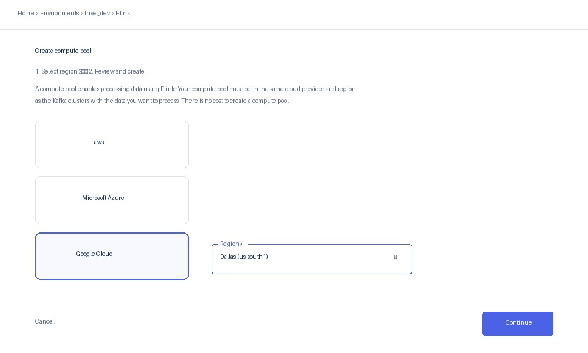
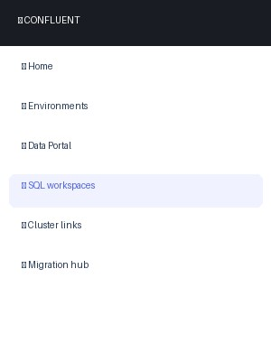

# Stream Processing with Apache Flink (Confluent Cloud)

## Overview & Goal

In the Hive workshop, your factory simulation emits discrete lifecycle events across different Kafka topics as resources are collected, components are manufactured, and worker robots are assembled. 

However, raw events only tell you what happened at an instant in time:
- A `*.started` event announces that a job began with a planned duration.
- A `*.completed` event announces that the job finished.

**The Problem:** There is no single event that tells you how long a job actually took, whether it ran on schedule, or how station performance is trending across stages.

**Your Objective:** As a stream processing engineer, you will use **Apache Flink on Confluent Cloud** to correlate unbounded event streams in real time. You will build an interval-join pipeline that pairs started and completed events by `job_id`, calculates accurate job durations, and outputs continuous, typed performance metrics to a unified `job_durations` stream.

```
┌─────────────────────────┐
│   *.started topic       ├──┐
└─────────────────────────┘  │   Flink Stateful Join
                             ├──► (matches on job_id)  ───►  job_durations table & topic
┌─────────────────────────┐  │   [within 1-min window]      (Schema Registry + Tableflow ready)
│   *.completed topic     ├──┘
└─────────────────────────┘
```

---

## What You Are Building

### 1. Input Streams
Your factory publishes raw JSON events across three production stages (defined in [`spec-shared/schemas/event_payloads.json`](../spec-shared/schemas/event_payloads.json)):

| Production Stage | Started Topic | Completed Topic | What It Represents |
|---|---|---|---|
| **Gathering** | `gathering-started` | `gathering-completed` | Resource extraction (pollen, nectar, wax) |
| **Manufacturing** | `manufacturing-started` | `manufacturing-completed` | Component production at stations (frames, honeycombs) |
| **Assembly** | `assembly-started` | `assembly-completed` | Final robot assembly lines |

Each event is wrapped in a standard envelope containing metadata (`occurred_at`, `sim_time_ms`, `factory_id`, `run_id`) and a `payload` containing `job_id` and `duration_ms`.

### 2. Output Stream (`job_durations`)
Flink produces a unified, append-only stream and backing Kafka topic named `job_durations`:

| Derived Metric / Field | Source / Calculation | Why It Matters |
|---|---|---|
| `job_id` | Shared `payload.job_id` | Correlates both events together |
| `stage` | `gathering`, `manufacturing`, or `assembly` | Allows cross-stage filtering and grouping |
| `subject` / `output_id` | `resource_id` or `station_id` | Identifies which station or item type was worked on |
| `elapsed_sim_ms` | `completed.sim_time_ms - started.sim_time_ms` | **Exact simulated duration.** Independent of clock drift or simulation speed. |
| `elapsed_wall_s` | Difference between `occurred_at` timestamps | **Real-world duration in seconds.** Measures real wall-clock latency. |
| `planned_duration_ms` | `payload.duration_ms` from started event | Expected target duration. Used to detect anomalies when compared with `elapsed_sim_ms`. |

---

## Why Stream-to-Stream Joins Need Watermarks and Windows

In traditional databases, you can join two tables at any time because all rows are stored on disk. In stream processing, events arrive continuously over time over unbounded streams. 

If Flink joined streams without time constraints, it would have to keep every `started` event in memory forever waiting for a possible `completed` event, eventually exhausting memory.

To solve this, our Flink queries use an **Interval Join**:
```sql
ON  s.job_id = c.job_id
AND c.row_time BETWEEN s.row_time - INTERVAL '5' SECOND AND s.row_time + INTERVAL '1' MINUTE;
```
This tells Flink:
1. Match records where `job_id` is identical.
2. Only retain state for 1 minute of Kafka record time. Once a `started` event is older than 1 minute without a match, it is evicted from state, keeping memory usage minimal and bounded.

---

## Step-by-Step Instructions

You will first configure your environment and run the pipeline using the **Confluent Cloud Web UI**. Once you understand how the jobs operate, you can optionally switch to the **Confluent CLI**.

### Step 1: Initial Setup via Confluent Cloud UI

> **Note on Schema Registry:** Schema Registry is already active because you selected the **Essentials** Stream Governance package when creating the `hive_dev` environment in Spec 2.

1. **Create Your Flink Compute Pool**:
   - In Confluent Cloud, navigate to your `hive_dev` environment.
   - In the left navigation, click **Flink** and go to the **Compute pools** tab.
   - Click **Add compute pool** (or **Create compute pool**).
   - Under **1. Select region**, select **Google Cloud** as the provider and choose **Dallas (us-south1)** as the region. Click **Continue**.
   - Under **2. Review and create**, leave the default **Pool name** as-is and click **Create**.

   

2. **Open the Flink SQL Workspace**:
   - In Confluent Cloud's main left-hand navigation, click **SQL workspaces** (accessible directly at the top level of the navigation menu).

   

   - In the workspace top navigation header, configure your execution context:
     - **Catalog**: `hive_dev` (your environment name)
     - **Database**: Select your Kafka cluster name
     - **Compute pool**: Select your active Flink Compute Pool

3. **Ensure Factory Data is Flowing**:
   - Ensure your simulation server and dashboard are running (see [`spec-2-hive-dashboard/attendee_get_started.md`](../spec-2-hive-dashboard/attendee_get_started.md)).
   - Click **Start** in the dashboard so events are actively published to `gathering-*`, `manufacturing-*`, and `assembly-*` topics.

---

### Step 2: Execute Flink SQL Statements

> **Note:** The Confluent SQL Workspace runs **one statement per execution**. Run each file in its own workspace query cell.

#### A. (Optional) Verify Input Event Parsing
Before deploying long-running stream jobs, verify that Flink can read and parse the raw JSON payloads from your Kafka topics.
- Open [`flink/03_validate.sql`](flink/03_validate.sql).
- Copy and run **Check A**.
- **Expected result:** You should see 5 rows with populated `job_id`, `sim_time_ms`, and `occurred_at`. If `NULL` values appear, ensure the factory is running and emitting data.

#### B. Create the Sink Table
- Open [`flink/01_create_sink.sql`](flink/01_create_sink.sql).
- Copy the entire SQL statement, paste it into the workspace, and click **Run**.
- **What this does:** Registers the `job_durations` table in Flink, generates the registered schema in Schema Registry, and creates the underlying Kafka topic with `append` changelog mode.

#### C. Deploy the Stream Processing Jobs
- Open [`flink/02_run_jobs.sql`](flink/02_run_jobs.sql).
- Copy the entire `EXECUTE STATEMENT SET ... BEGIN ... END;` block, paste it into the workspace, and click **Run**.
- **What this does:** Submits three continuous streaming jobs (gathering, manufacturing, assembly) bundled into a single Flink statement. Flink will continuously join incoming `started` and `completed` events and write the correlated duration records into `job_durations`.
- This statement will transition to the **Running** status.

#### D. Validate the Streaming Output
In [`flink/03_validate.sql`](flink/03_validate.sql), run the validation queries one at a time:
- **Check B (`SELECT * FROM job_durations LIMIT 20;`)**: Confirms derived duration records are actively arriving.
- **Check C (Anomaly check)**: Filters for any job where `elapsed_sim_ms <> planned_duration_ms`. In normal operation, this query returns 0 rows.
- **Check D (Stage & station aggregations)**: Aggregates average job durations and counts grouped by `stage` and `subject`.

To stop the background streaming job when finished, navigate to **Flink statements** in Confluent Cloud and click **Actions > Delete** (or **Stop**).

---

## Switching to Confluent CLI (Optional)

After exploring the UI, you can manage compute pools, submit statements, and run interactive SQL sessions directly from your terminal.

### 1. Install the Confluent CLI

#### macOS
Install via Homebrew:
```bash
brew install confluentinc/tap/cli
```
Or via curl:
```bash
curl -sL --http1.1 https://cnfl.io/cli | sh -s -- -b /usr/local/bin
```

#### Windows
Install via PowerShell:
```powershell
Invoke-WebRequest -Uri https://cnfl.io/cli -OutFile confluent-cli-install.ps1
powershell -ExecutionPolicy Bypass -File confluent-cli-install.ps1 -bin %USERPROFILE%\bin
```
Or via winget:
```powershell
winget install Confluent.ConfluentCLI
```

Verify the installation:
```bash
confluent version
```

### 2. Authenticate & Configure Context

1. Log in to Confluent Cloud:
   ```bash
   confluent login --save
   ```
2. Set your environment and Kafka cluster:
   ```bash
   confluent environment list
   confluent environment use <ENV_ID>

   confluent kafka cluster list
   confluent kafka cluster use <CLUSTER_ID>
   ```
3. List available Flink compute pools:
   ```bash
   confluent flink compute-pool list
   ```

### 3. Run Flink SQL via CLI

Submit a statement directly from a file:
```bash
confluent flink statement create create-job-durations-sink \
  --compute-pool <COMPUTE_POOL_ID> \
  --environment <ENV_ID> \
  --database <CLUSTER_ID> \
  --sql "$(cat flink/01_create_sink.sql)"
```

Or open an interactive Flink SQL shell:
```bash
confluent flink shell \
  --compute-pool <COMPUTE_POOL_ID> \
  --environment <ENV_ID> \
  --database <CLUSTER_ID>
```

---

## Technical Notes & Best Practices

- **Topic Creation:** `provision_topics.py` provisions the source topics. Do **not** pre-create `job_durations` manually; Flink creates and manages this topic and its schema.
- **Timestamp Resolution:** `elapsed_sim_ms` is exact and simulation-speed independent. `elapsed_wall_s` uses coarse whole seconds and will vary based on factory simulation speed.
- **Schema Registry & Tableflow:** The sink table uses `json-registry` (`JSON_SR`). Because Tableflow automatically materializes Kafka topics into Apache Iceberg tables, having a registered schema is mandatory.
- **Changelog Immutability:** The changelog mode is set to `append` in the DDL. Once a topic is materialized in Tableflow, its changelog mode cannot be changed.
